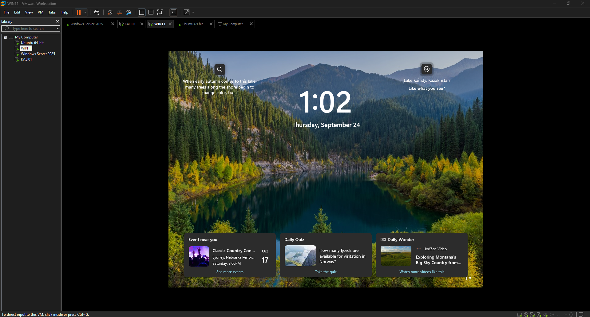
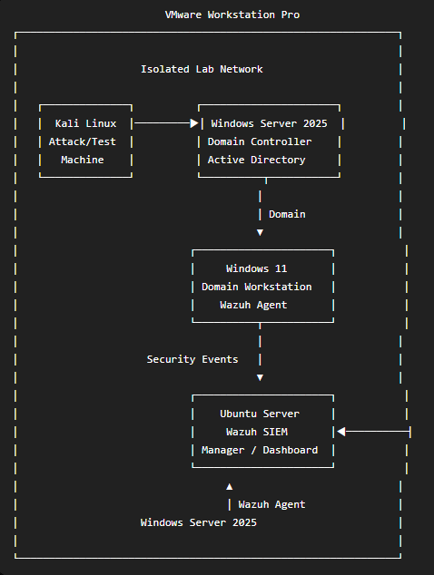
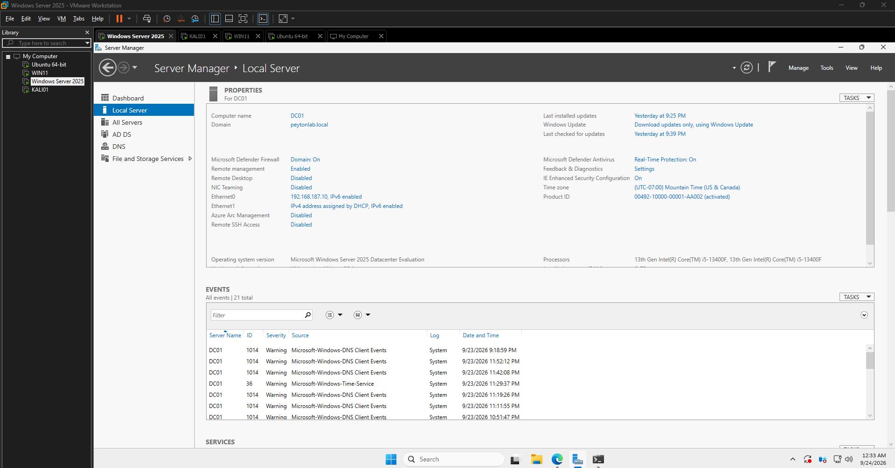
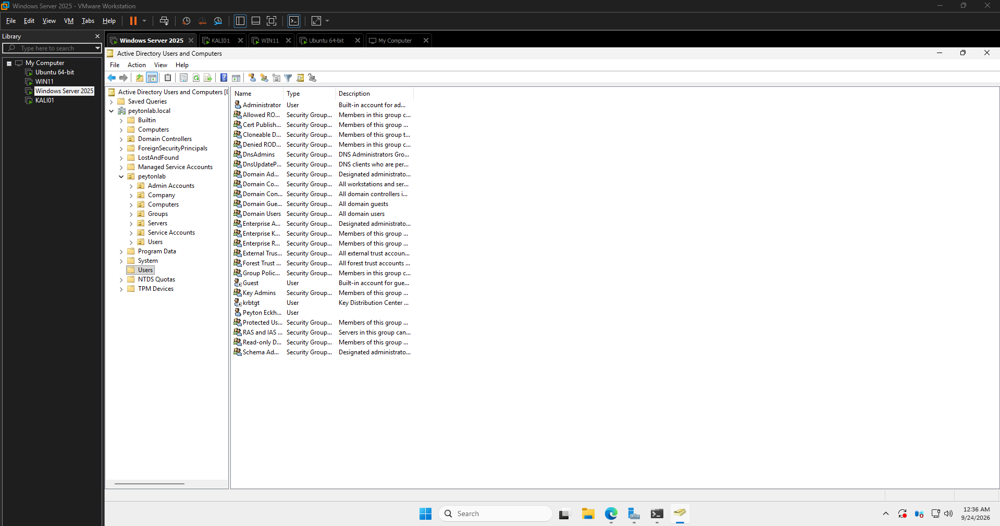
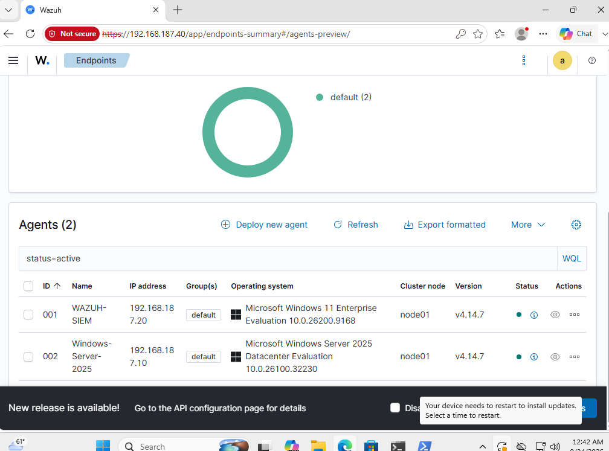
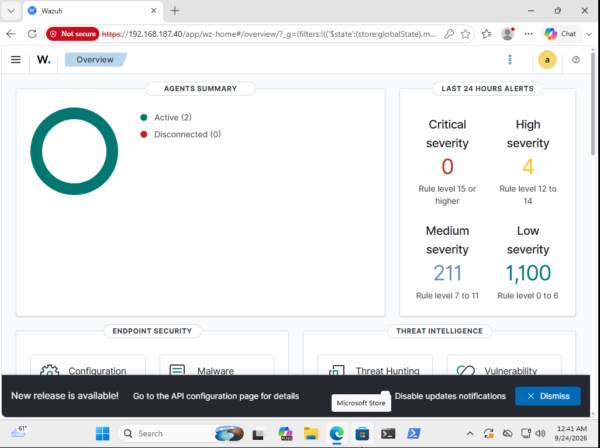

# Active-directory-wazuh-attack-detection-lab
Active Directory cybersecurity homelab demonstrating reconnaissance, Kerberos authentication attacks, and threat detection using Kali Linux, Windows Server 2025, Wazuh SIEM, and VMware Workstation Pro.
# Active Directory Attack & Detection Homelab

## 📖 Project Overview

This project documents an Active Directory cybersecurity homelab built using VMware Workstation Pro. The lab was created to practice both offensive security techniques and defensive security monitoring in an isolated environment.

The environment consists of a Windows Server 2025 domain controller, a Windows 11 domain-joined workstation, a Kali Linux security testing machine, and an Ubuntu Server running Wazuh SIEM.

Controlled security tests are performed from Kali Linux against systems and accounts created specifically for the homelab. Wazuh agents installed on the Windows endpoints collect security telemetry that can be analyzed through the Wazuh SIEM.

---

# ⚠️ Disclaimer

All security testing documented in this repository was performed within a privately owned and isolated VMware homelab.

All systems, accounts, credentials, and network resources used for testing were created specifically for cybersecurity education and experimentation.

No third-party systems or accounts were targeted.

---

## 🎯 Objectives

- Build and configure an Active Directory environment
- Join a Windows 11 workstation to the domain
- Deploy Wazuh agents to Windows endpoints
- Perform network reconnaissance with Nmap
- Enumerate Active Directory accounts with Kerbrute
- Simulate authentication attacks against test accounts
- Monitor Windows security events with Wazuh
- Correlate offensive activity with defensive telemetry
- Practice basic security incident investigation

---

## 🧰 Technologies Used

| Technology | Purpose |
|---|---|
| VMware Workstation Pro | Virtualization platform |
| Windows Server 2025 | Active Directory Domain Controller |
| Windows 11 | Domain-joined client |
| Ubuntu Server | Wazuh SIEM server |
| Kali Linux | Security testing workstation |
| Wazuh | SIEM and endpoint monitoring |
| Active Directory | Identity and domain management |
| Nmap | Network reconnaissance |
| Kerbrute | Kerberos/Active Directory security testing |

---

# 🏗️ Lab Architecture

The entire environment is hosted within VMware Workstation Pro and is used only for authorized cybersecurity testing.

## VMware Workstation Environment

The environment contains:

- Kali Linux
- Windows Server 2025
- Windows 11
- Ubuntu Server

## Network Architecture

The lab uses an isolated virtual network hosted in VMware Workstation Pro. Kali Linux serves as the security testing system, Windows Server 2025 provides Active Directory Domain Services, Windows 11 operates as a domain-joined workstation, and Wazuh SIEM running on Ubuntu Server provides centralized security monitoring.

Wazuh agents installed on the Windows Server 2025 domain controller and Windows 11 workstation forward security events to the Wazuh manager for analysis and detection.

---

# 🖥️ Active Directory Environment

## Windows Server 2025 Domain Controller

A Windows 11 workstation was joined to the Active Directory domain to simulate a normal enterprise endpoint.

## Windows Server 2025 Users and Computers

---

# 🛡️ Wazuh SIEM Deployment

Wazuh provides centralized security monitoring for the Windows systems in the homelab.

Wazuh agents were installed on:

- Windows Server 2025
- Windows 11

## Wazuh Agents

This screenshot demonstrates that both Windows endpoints are actively communicating with the Wazuh infrastructure.

## Wazuh Security Dashboard

The Wazuh dashboard provides centralized visibility into security events generated by monitored endpoints.
